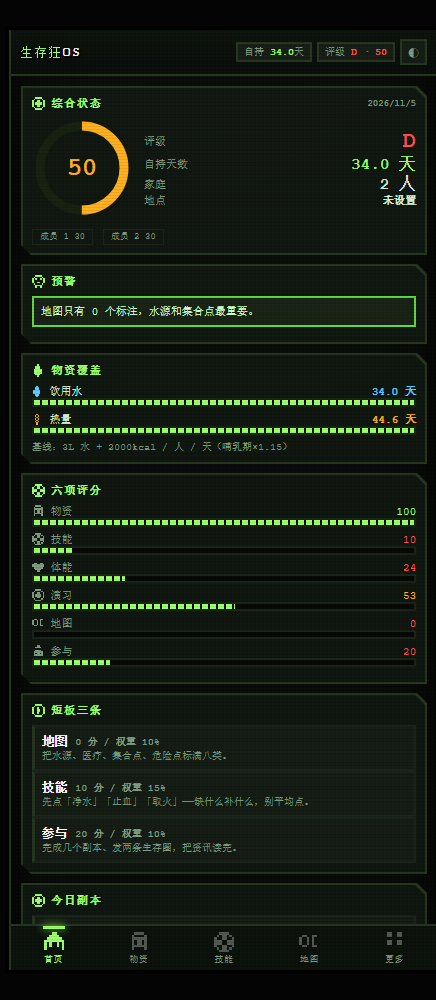

# 生存狂 OS · 家庭韧性系统

**一句话：把你家的物资、技能、体能算成「还能自持多少天」这个真实数字，并告诉你先补哪一块。**

👉 **在线打开：<https://fengdan123-123.github.io/prepper-os/>**（手机可直接用）



---

## 它解决什么问题

市面上的囤货清单都是「列一堆东西」——不告诉你够不够、差多少、先补什么。

这个工具把物资直接换算成天数：

- 水 **3L / 人 / 天**
- 热量 **2000 kcal / 人 / 天**（哺乳期 ×1.15）

再按你家的**实际人口**算，得出「自持 X 天」和评级，而不是一个凭感觉的分数。

## 有什么

| 模块 | 说明 |
|---|---|
| 综合状态 | 评级 + 自持天数 + 家庭成员 + 所在地 |
| 预警 | 水/热量还够几天、离目标差多少、哪些物资临期 |
| 物资覆盖 | 按**天数**算的进度条，不是按件数 |
| 六项评分 | 物资 / 技能 / 体能 / 演习 / 地图 / 参与，加权总分 |
| 短板三条 | 直接告诉你先补哪块，给具体动作，不说空话 |
| 技能 | 10 类 39 项，含净水、止血、取火、气味管理、云图判读、草药识别、伤口缝合、无线电测向 |
| 地图 | Leaflet + 高德底图，真实定位，标注周边医院/超市/药店/派出所 |
| 自建 | 副本、演习、训练都能自己加，另有 6 套预设模板 |
| 勋章 | 24 枚，铜/银/金三档，条件可计算 |
| 主题 | 右上角 ◐ 切换：战术绿 / 废土橙 / 夜航蓝 |

## 怎么用

1. 打开上面的链接（手机、电脑都行）
2. 进「家庭档案」填你家实际人口和现有物资
3. 回首页看自持天数和评级
4. 看「短板三条」，按它说的补

**数据全部存在你浏览器本地（localStorage），不上传服务器，每台设备各自独立。**

## 已知限制

- 周边设施搜索需要填一个免费的高德 Web 服务 Key（在「家庭档案 → 地图设置」），不填就只有底图
- 定位功能需要 https 或 localhost 才能用
- 地图底图需要联网
- 数据只在本地，换设备或清缓存会丢
- 国内直连 `github.io` 可能需要梯子

## 本地运行

下载 `index.html` 和 `js/` 目录，放在同一个文件夹，双击 `index.html` 即可。

定位功能需要本地服务，用任意静态服务器：

```bash
python -m http.server 8787
# 打开 http://localhost:8787
```

## 技术

纯前端单页，无构建、无依赖（地图走 Leaflet CDN）：HTML + CSS + 原生 JS。
39 个 8×8 像素图标为手绘 SVG 生成，不是 AI 生成图。

## 说明

个人项目，自用为主。没有加开源协议，想拿去改可以直接 fork。
